# Google Search Console MCP Server for SEOs — Sam GSC MCP

[](https://github.com/krishanthsam/sam-gsc-mcp/actions/workflows/ci.yml)


[](LICENSE)

**Sam GSC MCP** connects [Google Search Console](https://search.google.com/search-console/about) to your AI assistant so you can
analyse SEO data in plain English — "which pages lost clicks this month?", "find keyword cannibalization",
"is this URL indexed?". It works with **Claude Desktop, Claude Code, Cursor, VS Code, Windsurf, Codex CLI, Gemini CLI**
and any other MCP client.

It is an **all-in-one** server: search analytics, SEO insight tools, URL inspection, sitemaps, hourly data, CSV
export, the Indexing API and 11 ready-made SEO skills — in one place.

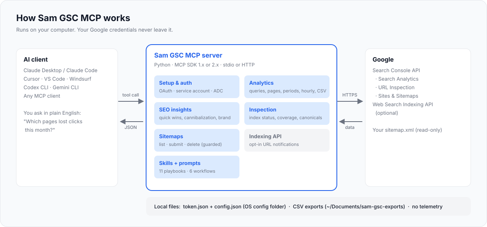

---

## Contents

- [What's New](#whats-new)
- [Features](#features)
- [Prerequisites](#prerequisites)
- [Setup Instructions](#setup-instructions) — [Step 1](#step-1--create-a-google-cloud-project) · [Step 2](#step-2--enable-the-search-console-api) · [Step 3](#step-3--configure-the-oauth-consent-screen) · [Step 4](#step-4--create-the-oauth-client-desktop-app) · [Service account](#alternative--service-account) · [Step 5](#step-5--install-and-connect-your-ai-client) · [Step 6](#step-6--sign-in-with-google-oauth-only) · [Step 7](#step-7--test-it)
- [Available Tools](#available-tools)
- [SEO Skills & Prompts](#seo-skills--prompts)
- [Environment Variables Reference](#environment-variables-reference)
- [Sample Prompts](#sample-prompts)
- [Safety & Privacy](#safety--privacy)
- [Remote Deployment & Docker](#remote-deployment--docker-advanced)
- [Troubleshooting](#troubleshooting)
- [Process Screenshots](#process-screenshots)
- [Contributing](#contributing) · [Credits](#credits) · [License](#license) · [Changelog](#changelog)

---

## What's New

### [1.0.0] — October 2026
- **One server, everything included** — 40 tools for analytics, insights, inspection, indexing and sitemaps.
- **SEO insight tools** — `find_striking_distance_keywords`, `find_keyword_cannibalization`, `get_brand_vs_nonbrand`
  and `find_low_ctr_opportunities` return ranked, ready-to-act lists instead of raw rows.
- **Hourly data** — `get_hourly_performance` uses Google's hourly Search Analytics data (last ~10 days).
- **CSV export** — `export_search_analytics` pulls up to 500,000 rows (auto-paginated) into a CSV on your computer.
- **Real Indexing API** — `request_indexing` / `get_indexing_status` (opt-in).
- **Coverage & mobile reports from live URL Inspection** — sampled from your top pages, your sitemap or a URL list.
- **No more exact-`site_url` headaches** — `example.com` is matched to `sc-domain:example.com` or
  `https://www.example.com/` automatically, and `GSC_SITE_URL` makes `site_url` optional.
- **Fix setup without restarting** — `setup_gsc_access` applies new credential paths in-chat (with interactive prompts on
  clients that support them).
- **Choose your tools** — `GSC_TOOLSETS`, `GSC_DISABLED_TOOLS` and `GSC_READ_ONLY` for clients with tool limits or
  cautious teams.
- **11 SEO skills + 6 one-click prompts**, a Claude Code plugin, and example configs for every major client.
- **Future-proof** — runs on MCP Python SDK 1.x *and* 2.x.

Full history: [CHANGELOG.md](CHANGELOG.md).

---

## Features

**Property management**
- List every Search Console property you can access, with permission levels
- Verification and ownership details
- Add or remove properties (guarded by a safety flag)

**Search analytics & reporting**
- Clicks, impressions, CTR and position by query, page, country, device, date, search appearance or hour
- Up to 25,000 rows per call with pagination, sorting, regex filters and multi-filter AND logic
- Web, Image, Video, News, Discover and Google News search types
- Performance overview with daily trend, best/worst day
- This period vs previous period summary with % changes
- Item-by-item period comparison (gainers, losers, new and lost queries/pages)
- Queries for a single page
- Hourly performance (last ~10 days)
- Bulk CSV export

**SEO insights (computed for you)**
- Striking-distance keywords (positions 4–20) ranked by estimated click gain
- Keyword cannibalization with a suggested primary page per query
- Branded vs non-branded traffic share
- Low-CTR / "silent reference" pages (likely answered by AI Overviews or snippets)

**URL inspection & indexing**
- Full inspection: index verdict, coverage state, last crawl, Google vs declared canonical, robots, fetch state,
  rich results (with issues), mobile usability and AMP
- Quick "is it indexed?" check
- Batch inspection and grouped indexing-issue report (concurrent, quota-aware)
- Coverage report and mobile signals sampled from top pages, a sitemap or your list
- Optional Indexing API notifications (`URL_UPDATED` / `URL_DELETED`)

**Sitemaps**
- List (including children of a sitemap index), details, submit/resubmit, delete (guarded)

**Built for AI assistants**
- 11 SEO playbooks (skills) and 6 workflow prompts, also exposed as MCP resources
- Schema discovery tools so the AI never guesses dimension or operator names
- Friendly JSON errors that say exactly how to fix the problem
- Tool annotations (read-only / destructive hints) for safer client approvals

**Auth & operations**
- OAuth (your Google account), service account, or Application Default Credentials
- Read-only mode, destructive-operation flag, tool-group filtering
- stdio (default), SSE and streamable HTTP transports; Docker image
- Works with MCP SDK 1.x and 2.x; Python 3.10–3.13; no telemetry

---

## Prerequisites

| You need | Why | How to check |
|---|---|---|
| A Google account with access to at least one **Search Console property** | Source of the data | Open [search.google.com/search-console](https://search.google.com/search-console) |
| A **Google Cloud project** (free) | To create API credentials | [console.cloud.google.com](https://console.cloud.google.com/) |
| An **MCP-compatible AI client** | Where you chat | Claude Desktop, Claude Code, Cursor, VS Code, Windsurf, Codex CLI, Gemini CLI… |
| **uv** (recommended) *or* Python **3.10+** | Runs the server | `uv --version` or `python3 --version` |

Install **uv** (it downloads the right Python for you):

```bash
# macOS / Linux
curl -LsSf https://astral.sh/uv/install.sh | sh
source $HOME/.local/bin/env            # use it in the current terminal
```

```powershell
# Windows (PowerShell)
powershell -ExecutionPolicy ByPass -c "irm https://astral.sh/uv/install.ps1 | iex"
```

Then find the full path to `uvx` — you'll paste it into your AI client config:

```bash
which uvx          # macOS/Linux → e.g. /Users/you/.local/bin/uvx
where uvx          # Windows     → e.g. C:\Users\you\.local\bin\uvx.exe
```

> **Note:** local MCP servers run on your computer, so use the **desktop/CLI apps**. The claude.ai website cannot start a
> local server (see [Remote deployment](#remote-deployment--docker-advanced) if you need that).

---

## Setup Instructions

Choose how the server signs in to Google:

| Method | Best for | Steps |
|---|---|---|
| **OAuth** (recommended) | Individuals and consultants — uses your own Google account and every property it can see | 1 → 2 → 3 → 4 → 5 → 6 → 7 |
| **Service account** | Automation, servers, teams — a robot account you add to each property | 1 → 2 → [Service account](#alternative--service-account) → 5 → 7 |

### Step 1 — Create a Google Cloud project

1. Go to [console.cloud.google.com](https://console.cloud.google.com/) and open the **project picker** at the top.
2. Click **New project**, name it (for example `sam-gsc-mcp`) and click **Create**.
3. Make sure the new project is selected in the picker.

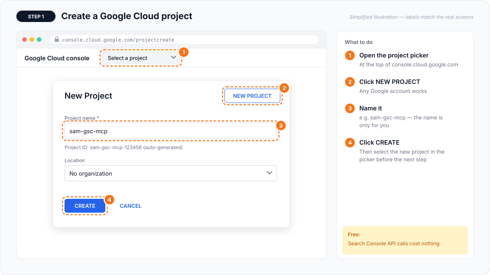

### Step 2 — Enable the Search Console API

1. Open [Google Search Console API](https://console.cloud.google.com/apis/library/searchconsole.googleapis.com) in the API Library.
2. Click **Enable**.
3. *(Optional)* Only if you will use `request_indexing`: also enable the
   [Web Search Indexing API](https://console.cloud.google.com/apis/library/indexing.googleapis.com).

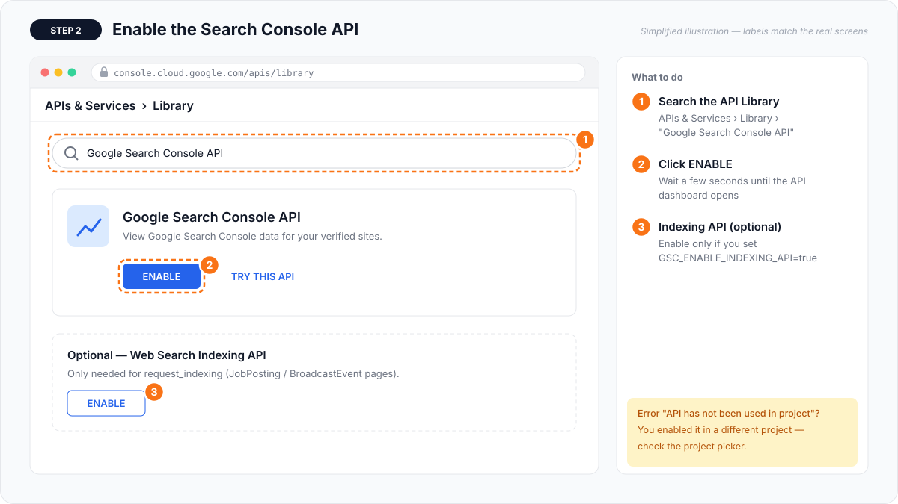

### Step 3 — Configure the OAuth consent screen

1. Open [Google Auth Platform](https://console.cloud.google.com/auth/overview) and click **Get started**.
2. **Branding:** app name `Sam GSC MCP`, your email as support and developer contact.
3. **Audience:** choose **External**.
4. **Test users:** add the Gmail/Workspace address that has access to your Search Console properties.
5. **Recommended:** click **Publish app**. In *Testing* mode Google expires refresh tokens after 7 days, which means
   signing in again every week. Publishing your own app is fine — you will just see an "unverified app" notice once.

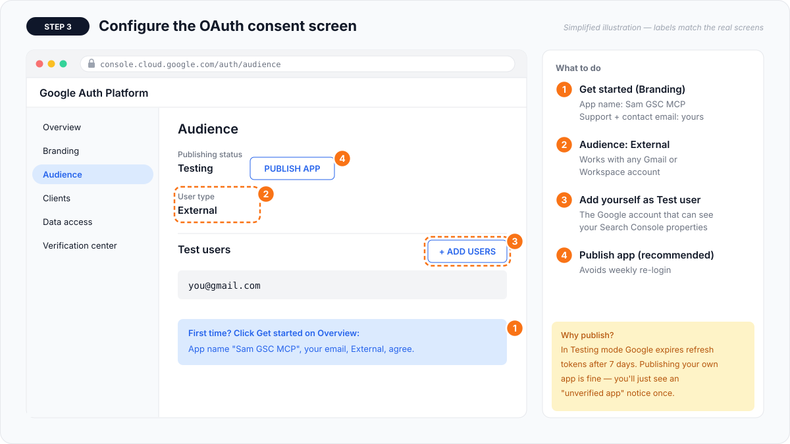

### Step 4 — Create the OAuth client (Desktop app)

1. In Google Auth Platform go to [Clients](https://console.cloud.google.com/auth/clients) → **Create client**.
2. Application type: **Desktop app** (not "Web application"). Name it anything.
3. Click **Create**, then **Download JSON**.
4. Save the file somewhere permanent, e.g. `~/secure/client_secrets.json`, and note its **absolute path**.

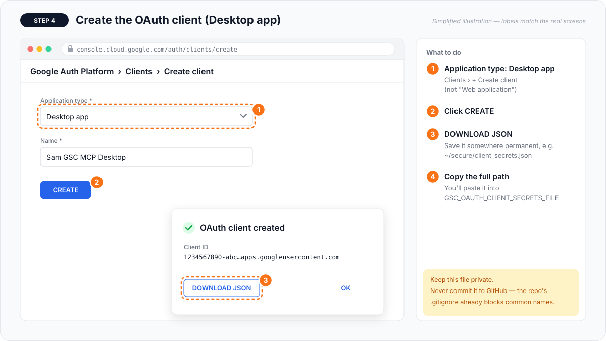

> Keep this file private. Never commit it — this repo's `.gitignore` already blocks common credential file names.

### Alternative — Service account

1. Go to [IAM & Admin → Service accounts](https://console.cloud.google.com/iam-admin/serviceaccounts) → **Create service account**
   (no project roles are needed).
2. Open it → **Keys** → **Add key** → **Create new key** → **JSON** → **Create**. The key downloads; store it safely.
3. Copy the `client_email` (e.g. `gsc-bot@your-project.iam.gserviceaccount.com`).
4. In Search Console, for **each property**: **Settings → Users and permissions → Add user**, paste the email,
   permission **Full** (use **Owner** only if you will use the Indexing API).

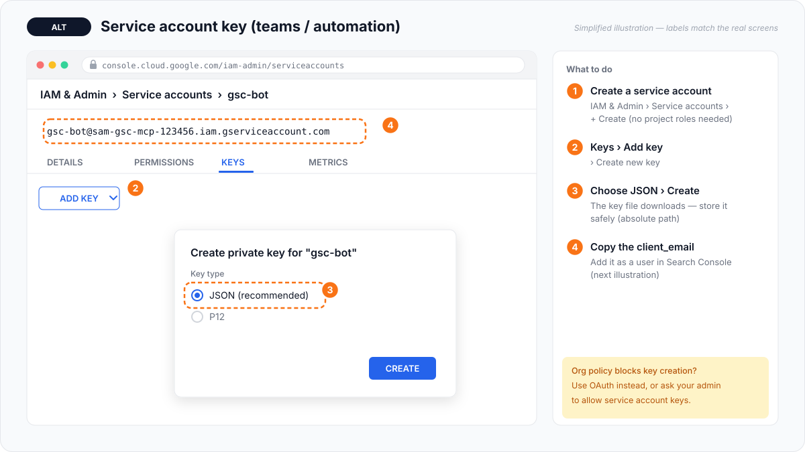
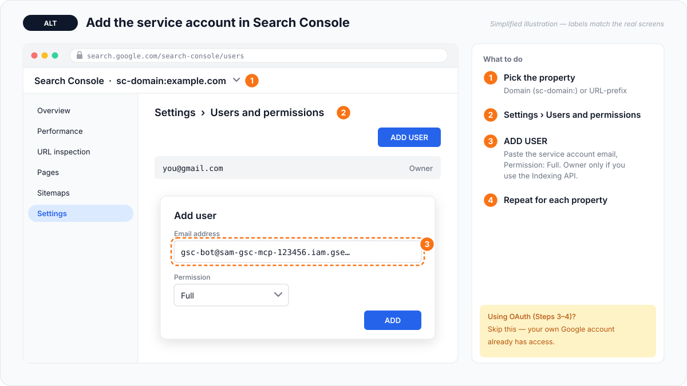

### Step 5 — Install and connect your AI client

Nothing to clone — `uvx` downloads and runs the server straight from GitHub. Replace `/FULL/PATH/TO/...` with your paths.

#### Claude Desktop

Open **Settings → Developer → Edit Config** (macOS: `~/Library/Application Support/Claude/claude_desktop_config.json`,
Windows: `%APPDATA%\Claude\claude_desktop_config.json`).

**OAuth:**
```json
{
  "mcpServers": {
    "sam-gsc": {
      "command": "/FULL/PATH/TO/uvx",
      "args": ["--from", "git+https://github.com/krishanthsam/sam-gsc-mcp", "sam-gsc-mcp"],
      "env": {
        "GSC_OAUTH_CLIENT_SECRETS_FILE": "/FULL/PATH/TO/client_secrets.json",
        "GSC_SITE_URL": "sc-domain:example.com"
      }
    }
  }
}
```

**Service account:**
```json
{
  "mcpServers": {
    "sam-gsc": {
      "command": "/FULL/PATH/TO/uvx",
      "args": ["--from", "git+https://github.com/krishanthsam/sam-gsc-mcp", "sam-gsc-mcp"],
      "env": {
        "GSC_CREDENTIALS_PATH": "/FULL/PATH/TO/service_account.json",
        "GSC_SKIP_OAUTH": "true"
      }
    }
  }
}
```

`GSC_SITE_URL` is optional — it sets a default property so you don't have to name it every time.
Save, then **fully quit** Claude Desktop (Cmd+Q on macOS, or right-click the tray icon → Quit on Windows) and reopen it.

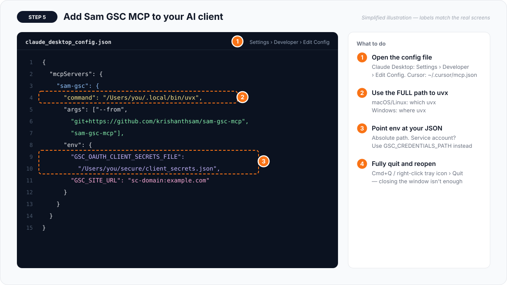

#### Claude Code

```bash
claude mcp add sam-gsc --scope user \
  -e GSC_OAUTH_CLIENT_SECRETS_FILE=/FULL/PATH/TO/client_secrets.json \
  -- uvx --from git+https://github.com/krishanthsam/sam-gsc-mcp sam-gsc-mcp
```

Or install it as a **plugin** (server + all 11 skills):

```text
/plugin marketplace add krishanthsam/sam-gsc-mcp
/plugin install sam-gsc-mcp@sam-gsc-mcp
```
The plugin reads `GSC_OAUTH_CLIENT_SECRETS_FILE`, `GSC_CREDENTIALS_PATH` and `GSC_SITE_URL` from your shell environment.

#### Cursor

`~/.cursor/mcp.json` (or **Settings → MCP → Add new server**) — same JSON as Claude Desktop. Cursor limits the total
number of tools, so you can load only some groups:

```json
"env": {
  "GSC_OAUTH_CLIENT_SECRETS_FILE": "/FULL/PATH/TO/client_secrets.json",
  "GSC_TOOLSETS": "setup,properties,analytics,insights,inspection,sitemaps"
}
```

#### VS Code (GitHub Copilot agent mode)

`.vscode/mcp.json` in your workspace, or **MCP: Add Server** from the command palette:

```json
{
  "servers": {
    "sam-gsc": {
      "type": "stdio",
      "command": "/FULL/PATH/TO/uvx",
      "args": ["--from", "git+https://github.com/krishanthsam/sam-gsc-mcp", "sam-gsc-mcp"],
      "env": { "GSC_OAUTH_CLIENT_SECRETS_FILE": "/FULL/PATH/TO/client_secrets.json" }
    }
  }
}
```

#### Windsurf, Gemini CLI, Codex CLI and others

| Client | Config file | Example |
|---|---|---|
| Windsurf | `~/.codeium/windsurf/mcp_config.json` | same JSON as Claude Desktop |
| Gemini CLI | `~/.gemini/settings.json` | [examples/gemini-cli.settings.json](examples/gemini-cli.settings.json) |
| Codex CLI | `~/.codex/config.toml` | [examples/codex.config.toml](examples/codex.config.toml) |
| Windows paths | — | [examples/claude_desktop_config.windows.json](examples/claude_desktop_config.windows.json) |

All examples live in [`examples/`](examples/).

#### Option B — Clone (to modify the code)

```bash
git clone https://github.com/krishanthsam/sam-gsc-mcp.git
cd sam-gsc-mcp
uv venv && uv pip install -e ".[dev]"      # or: python3 -m venv .venv && .venv/bin/pip install -e ".[dev]"
```

Then point your client at the virtual-env Python:

```json
"command": "/FULL/PATH/TO/sam-gsc-mcp/.venv/bin/python",
"args": ["-m", "sam_gsc_mcp"]
```
(Windows: `C:\\path\\to\\sam-gsc-mcp\\.venv\\Scripts\\python.exe`.) Run the tests with `pytest`.

### Step 6 — Sign in with Google (OAuth only)

The first time a tool needs data (or when you ask the AI to run `reauthenticate`), a browser tab opens:

1. Pick the Google account that can see your Search Console properties.
2. If you see **"Google hasn't verified this app"**, click **Advanced → Go to Sam GSC MCP** — it's your own OAuth client.
3. Allow **"View and manage Search Console data"**.
4. When the tab says *"Sam GSC MCP is connected"*, close it. The token is saved in your OS config folder and refreshed
   automatically — you won't be asked again.

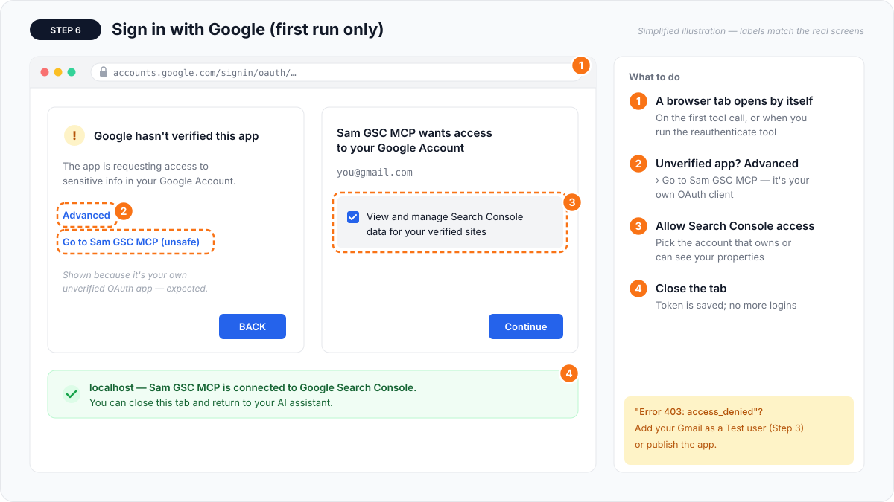

### Step 7 — Test it

Ask your assistant:

> **List my GSC properties.**

You should see your properties. If not, ask **"call get_capabilities"** — it reports the auth status, the settings in
use and which tools are enabled.

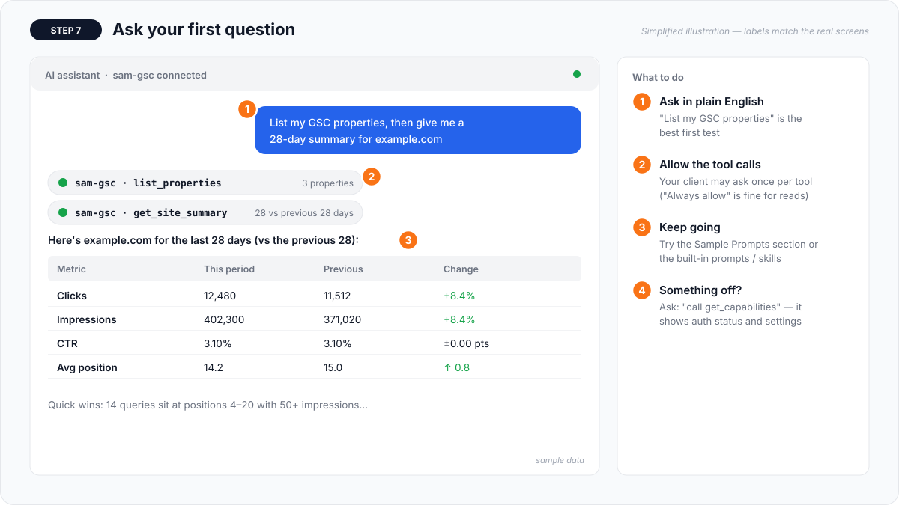

---

## Available Tools

40 tools (38 enabled by default) in 9 groups. `site_url` is optional everywhere when `GSC_SITE_URL` is set, and accepts
`example.com`, `https://www.example.com/` or `sc-domain:example.com`.

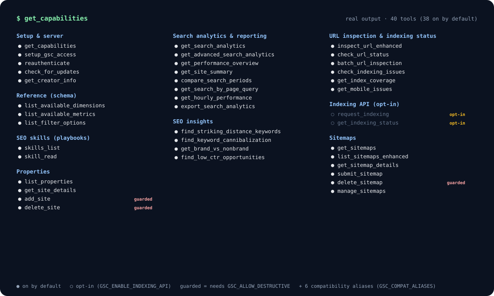

### Setup & server
| Tool | What it does | You provide |
|---|---|---|
| `get_capabilities` | All tools by group, auth status, active settings — call this first if unsure | Nothing |
| `setup_gsc_access` | Set or fix credentials / default property in-chat, verified and saved (paths only) | Optional file path, site URL |
| `reauthenticate` | Open Google sign-in again (first login, expired token, switch account) | Nothing |
| `check_for_updates` | Compare your version with the latest on GitHub | Nothing |
| `get_creator_info` | About the author and credits | Nothing |

### Reference (schema)
| Tool | What it does | You provide |
|---|---|---|
| `list_available_dimensions` | query, page, country, device, date, searchAppearance, hour — with meanings | Nothing |
| `list_available_metrics` | clicks, impressions, ctr (%), position | Nothing |
| `list_filter_options` | Operators, search types, device values, search appearances, data states, examples | Nothing |

### SEO skills (playbooks)
| Tool | What it does | You provide |
|---|---|---|
| `skills_list` | List the 11 bundled SEO playbooks | Nothing |
| `skill_read` | Full step-by-step playbook | Skill id |

### Properties
| Tool | What it does | You provide |
|---|---|---|
| `list_properties` | All properties + permission level (start here) | Nothing |
| `get_site_details` | Permission, verification and ownership info | Site |
| `add_site` 🔒 | Add a property (then verify it in Search Console) | Site |
| `delete_site` 🔒 | Remove a property | Site |

### Search analytics & reporting
| Tool | What it does | You provide |
|---|---|---|
| `get_search_analytics` | Top queries/pages/countries/devices/dates; filters, search type, `summary_only` | Site, days or dates, dimensions |
| `get_advanced_search_analytics` | Up to 25k rows, pagination, sorting, regex, multi-filter AND | Site, dates, dimensions, filters |
| `get_performance_overview` | Totals + daily trend + best/worst day | Site, days |
| `get_site_summary` | This period vs previous period with % changes | Site, period length |
| `compare_search_periods` | Item-by-item comparison: gainers, losers, new, lost | Site, two date ranges (optional) |
| `get_search_by_page_query` | Queries driving traffic to one page | Site, page URL |
| `get_hourly_performance` | Hour-by-hour data for the last ~10 days, peak hour | Site, days (1–10) |
| `export_search_analytics` | CSV export, auto-paginated up to 500k rows | Site, dimensions, dates |

### SEO insights
| Tool | What it does | You provide |
|---|---|---|
| `find_striking_distance_keywords` | Queries at positions 4–20 ranked by estimated extra clicks | Site (thresholds optional) |
| `find_keyword_cannibalization` | Queries where 2+ of your pages compete, with suggested primary page | Site |
| `get_brand_vs_nonbrand` | Branded vs non-branded share, CTR, position, top queries | Site, brand terms |
| `find_low_ctr_opportunities` | Top-ranking rows with weak CTR (title/meta or AI Overview "silent reference") | Site |

### URL inspection & indexing status
| Tool | What it does | You provide |
|---|---|---|
| `inspect_url_enhanced` | Full inspection incl. rich-result issues, mobile, AMP, canonicals | Site, page URL |
| `check_url_status` | Quick indexed yes/no with key fields | Site, page URL |
| `batch_url_inspection` | Inspect up to 10 URLs at once (configurable) | Site, URLs |
| `check_indexing_issues` | Group URLs into not indexed / canonical / robots / noindex / fetch / rich-result buckets | Site, URLs |
| `get_index_coverage` | Coverage states with counts and examples from top pages, sitemap or list | Site, source |
| `get_mobile_issues` | Crawled-as device, fetch state and any mobile-usability data | Site, URLs (optional) |

### Indexing API (opt-in: `GSC_ENABLE_INDEXING_API=true`)
| Tool | What it does | You provide |
|---|---|---|
| `request_indexing` | Notify Google of updated (or, 🔒, deleted) URLs | URLs |
| `get_indexing_status` | Last notification Google received for a URL | URL |

> Google officially supports the Indexing API only for pages with **JobPosting** or **BroadcastEvent** markup, the
> account must be an **Owner** of the property, and the default quota is 200 notifications per day. For other pages use
> **Request indexing** in Search Console's URL Inspection.

### Sitemaps
| Tool | What it does | You provide |
|---|---|---|
| `get_sitemaps` | All sitemaps with status, errors, warnings, URL counts | Site |
| `list_sitemaps_enhanced` | Detailed list, optionally children of a sitemap index | Site |
| `get_sitemap_details` | One sitemap's status and content breakdown | Site, sitemap URL |
| `submit_sitemap` | Submit or resubmit a sitemap | Site, sitemap URL |
| `delete_sitemap` 🔒 | Unsubmit a sitemap | Site, sitemap URL |
| `manage_sitemaps` | All-in-one: list / details / submit / delete | Site, action |

🔒 = disabled until `GSC_ALLOW_DESTRUCTIVE=true`.

**Compatibility aliases** (`GSC_COMPAT_ALIASES=true`): `list_sites`, `list_gsc_sites`, `get_performance_data`,
`get_url_inspection_result`, `get_sitemap_data`, `submit_url` — common alternative tool names, so older prompts keep working.

**Output conventions:** every tool returns compact JSON. `ctr` is a **percentage** (3.25 = 3.25 %), `position` is an
average where **lower is better**, and errors come back as `{"error": "...", "how_to_fix": [...]}`.

---

## SEO Skills & Prompts

Skills are step-by-step playbooks the AI can read with `skill_read` (also available as MCP resources `skill://<id>` and,
in Claude Code, as plugin skills). Prompts appear in your client's prompt or slash-command menu.

| Skill | Ask for it like this | What you get |
|---|---|---|
| `seo-weekly-report` | "Run the SEO weekly report for example.com" | Snapshot vs previous period, alerts, top queries/pages, quick wins |
| `keyword-cannibalization` | "Check keyword cannibalization" | Competing pages per query and which to keep |
| `indexing-audit` | "Audit indexing for my top pages" | Coverage buckets and a prioritised fix list |
| `content-opportunities` | "Find content quick wins" | Striking-distance, CTR gaps and content gaps |
| `brand-visibility` | "How much of my traffic is branded?" | Brand vs non-brand share and issues |
| `citation-opportunities` | "Which pages rank #1 but get no clicks?" | AI Overview / snippet "silent reference" pages |
| `intent-efficiency` | "Split my traffic by search intent" | Informational / commercial / transactional mix |
| `intent-segmentation` | "Are people searching with long AI-style prompts?" | Searchers vs prompters |
| `search-appearance-audit` | "Audit my rich results" | Appearance performance and markup issues |
| `diagnose-traffic-drop` | "Why did my traffic drop last week?" | When, where and the likely cause |
| `content-decay` | "Which old pages should I refresh?" | Pages losing clicks and what they lost |

**Prompts:** `seo-weekly-report`, `content-opportunities`, `cannibalization-check`, `indexing-audit`,
`analyze-brand-visibility`, `diagnose-traffic-drop`.

---

## Environment Variables Reference

All paths must be **absolute** (`~` and `$HOME` are expanded). A full commented template is in [`.env.example`](.env.example).

### Authentication
| Variable | Default | Description |
|---|---|---|
| `GSC_OAUTH_CLIENT_SECRETS_FILE` | — | Path to your OAuth **Desktop app** client JSON. Required for OAuth with uvx. |
| `GSC_CREDENTIALS_PATH` | — | Path to a service account JSON key. `GOOGLE_APPLICATION_CREDENTIALS` is accepted too. |
| `GSC_AUTH_MODE` | `auto` | `auto` (OAuth → service account → ADC), `oauth`, `service_account` or `adc` |
| `GSC_SKIP_OAUTH` | `false` | `true` forces service-account auth (same as `GSC_AUTH_MODE=service_account`) |
| `GSC_USE_ADC` | `false` | Allow Application Default Credentials in `auto` mode (`gcloud auth application-default login`, GCP metadata) |
| `GSC_OAUTH_PORT` | `0` | Local port for the OAuth redirect (`0` = random). Fix it when tunnelling to a remote machine. |
| `GSC_OAUTH_TIMEOUT` | `300` | Seconds to wait for the browser sign-in |

### Behaviour
| Variable | Default | Description |
|---|---|---|
| `GSC_SITE_URL` | — | Default property when a tool is called without `site_url` |
| `GSC_DATA_STATE` | `all` | `all` matches the Search Console dashboard; `final` = confirmed data only (2–3 day lag) |
| `GSC_READ_ONLY` | `false` | `true` = read-only OAuth scope; hides every write tool |
| `GSC_ALLOW_DESTRUCTIVE` | `false` | `true` enables `add_site`, `delete_site`, `delete_sitemap` and `URL_DELETED` notifications |
| `GSC_ENABLE_INDEXING_API` | `false` | `true` adds the Indexing API scope and the `request_indexing` / `get_indexing_status` tools |
| `GSC_TOOLSETS` | `all` | Comma list of groups to load: `setup, reference, skills, properties, analytics, insights, inspection, indexing, sitemaps` (setup is always kept) |
| `GSC_DISABLED_TOOLS` | — | Comma list of individual tools to hide |
| `GSC_COMPAT_ALIASES` | `false` | `true` also registers alternative tool names (`list_sites`, `submit_url`, …) |
| `GSC_MAX_BATCH_URLS` | `10` | Max URLs per inspection batch (1–100). URL Inspection quota: 2,000/day, 600/min per property. |
| `GSC_INSPECTION_CONCURRENCY` | `10` | Parallel URL inspections (1–20) |
| `GSC_API_RETRIES` | `3` | Automatic retries on 429/5xx |
| `GSC_UPDATE_CHECK` | `true` | `false` stops `check_for_updates` from calling GitHub |
| `GSC_LOG_LEVEL` | `WARNING` | Server log level (stderr) |

### Files
| Variable | Default | Description |
|---|---|---|
| `GSC_CONFIG_DIR` | OS config folder (`~/Library/Application Support/sam-gsc-mcp`, `~/.config/sam-gsc-mcp`, `%LOCALAPPDATA%\sam-gsc-mcp\sam-gsc-mcp`) | Where `token.json` and `config.json` live |
| `GSC_TOKEN_FILE` | `<config dir>/token.json` | OAuth token location |
| `GSC_EXPORT_DIR` | `~/Documents/sam-gsc-exports` | CSV export folder |

### Transport (remote use)
| Variable | Default | Description |
|---|---|---|
| `MCP_TRANSPORT` | `stdio` | `stdio`, `sse` or `streamable-http` (`http` works as an alias) |
| `MCP_HOST` | `127.0.0.1` | Bind address |
| `MCP_PORT` | `3001` | Port |
| `MCP_PATH` | `/mcp` | Endpoint path for streamable HTTP |

Settings saved by `setup_gsc_access` go to `<config dir>/config.json`; environment variables always win over it.

---

## Sample Prompts

| Tool | Sample prompt |
|---|---|
| `list_properties` | "List all my GSC properties and tell me which ones are domain properties." |
| `get_search_analytics` | "Show the top 20 queries for example.com in the last 30 days, highlight any with CTR below 2% and suggest better titles." |
| `get_performance_overview` | "Give me a visual performance overview of example.com for the last 90 days and explain any spikes or drops." |
| `get_site_summary` | "How did example.com do this month compared with last month?" |
| `compare_search_periods` | "Compare September with August — which queries and pages gained or lost the most clicks?" |
| `get_search_by_page_query` | "Which queries bring traffic to https://example.com/services/gst-registration/?" |
| `get_advanced_search_analytics` | "Mobile traffic in India only: queries with 100+ impressions and position worse than 10." |
| `get_hourly_performance` | "We published a post yesterday at 9am — show hourly clicks for the last 3 days." |
| `export_search_analytics` | "Export all query + page data for the last 6 months to CSV." |
| `find_striking_distance_keywords` | "Find my quick-win keywords and tell me what to change on each page." |
| `find_keyword_cannibalization` | "Do I have keyword cannibalization? Recommend which pages to merge." |
| `get_brand_vs_nonbrand` | "What share of my clicks is branded? Brand terms: acme, acme corp, akme." |
| `find_low_ctr_opportunities` | "Which pages rank in the top 5 but get almost no clicks? Rewrite their titles." |
| `inspect_url_enhanced` | "Inspect https://example.com/pricing and give me actionable fixes." |
| `check_indexing_issues` | "Check these pages for indexing problems: example.com/a, example.com/b, example.com/c" |
| `get_index_coverage` | "Build an index coverage report from my sitemap." |
| `get_sitemaps` | "Do any of my sitemaps have errors?" |
| `submit_sitemap` | "Submit https://example.com/sitemap_index.xml." |
| `skill_read` | "Run the diagnose-traffic-drop skill for the drop that started on 2 October." |

**Multi-step requests that work well**
- "Run the SEO weekly report for example.com and turn it into a client-ready summary."
- "Find content decay: pages that lost the most clicks over the last 3 months, and what queries they lost."
- "Audit indexing for my top 20 pages and prioritise the fixes."
- "Split my queries by intent and tell me which service pages I'm missing."

---

## Safety & Privacy

- **Runs locally.** Credentials stay on your machine; the server only talks to Google's APIs (and, if you ask, GitHub
  for `check_for_updates` and your own sitemap URL for coverage reports). **No telemetry.**
- **Destructive operations are off by default** (`GSC_ALLOW_DESTRUCTIVE`). Tool annotations mark them so clients can
  ask for confirmation.
- **Read-only mode** (`GSC_READ_ONLY=true`) requests the `webmasters.readonly` scope and hides every write tool.
- `setup_gsc_access` stores only **file paths** in `config.json`, never key contents. The OAuth token is saved with
  user-only file permissions.
- Never commit `client_secrets.json`, service account keys or `token.json` — `.gitignore` blocks the common names.

---

## Remote Deployment & Docker (Advanced)

Only needed if you want to run the server on another machine. For desktop use, stdio is simpler and safer.

```bash
MCP_TRANSPORT=streamable-http MCP_HOST=0.0.0.0 MCP_PORT=3001 \
GSC_CREDENTIALS_PATH=/secrets/service_account.json GSC_SKIP_OAUTH=true \
uvx --from git+https://github.com/krishanthsam/sam-gsc-mcp sam-gsc-mcp
# clients connect to http://HOST:3001/mcp   (SSE: MCP_TRANSPORT=sse → http://HOST:3001/sse)
```

**Docker** (service account recommended — there is no browser inside a container):

```bash
docker build -t sam-gsc-mcp .
docker run -p 3001:3001 \
  -e GSC_CREDENTIALS_PATH=/secrets/service_account.json -e GSC_SKIP_OAUTH=true -e GSC_READ_ONLY=true \
  -v /path/to/service_account.json:/secrets/service_account.json:ro \
  -v sam-gsc-data:/data \
  sam-gsc-mcp
```
Or use [`examples/docker-compose.yml`](examples/docker-compose.yml).

> ⚠️ The HTTP transport has **no built-in authentication**. Keep it on localhost, a private network/VPN, or behind a
> reverse proxy that adds auth and HTTPS. Anyone who can reach the port can read your Search Console data.

OAuth on a remote machine: set `GSC_OAUTH_PORT=8765`, forward it (`ssh -L 8765:localhost:8765 server`), then open the
sign-in URL printed in the server log.

---

## Troubleshooting

### `spawn uvx ENOENT` / `command not found: uvx`
Your AI client can't find `uvx`. Use the **full path** from `which uvx` (macOS/Linux) or `where uvx` (Windows) as
`"command"`. GUI apps don't read your shell profile, so plain `uvx` often fails.

### `uv --version` says "command not found" right after installing
Run `source $HOME/.local/bin/env`, then add it to your shell profile: `echo 'source $HOME/.local/bin/env' >> ~/.zshrc`.

### No tools appear in the client
1. Fully quit and reopen the app after editing the config (closing the window isn't enough).
2. Check the JSON is valid (no trailing commas).
3. Look at the MCP log: Claude Desktop → Settings → Developer → *Open Logs Folder* (`mcp-server-sam-gsc.log`).
4. The first `uvx` run downloads packages and can take a minute; if the client times out, run
   `uvx --from git+https://github.com/krishanthsam/sam-gsc-mcp sam-gsc-mcp` once in a terminal (stop it with Ctrl+C), then restart the client.

### "Not authenticated" / credentials file not found
- Use **absolute** paths: `/Users/you/secure/client_secrets.json` ✅ · `client_secrets.json` ❌
- With uvx the server runs from a cache folder, so files "next to the server" are never found — always set the env var.
- Ask the AI to **call `get_capabilities`** (shows exactly what's wrong) or **`setup_gsc_access`** with the path.

### `Error 403: access_denied` during Google sign-in
Your account isn't a test user of the OAuth app. Add it under Google Auth Platform → **Audience → Test users**, or
publish the app (Step 3).

### Signed in, but I have to log in again every week
The OAuth app is in *Testing* mode, where Google expires refresh tokens after 7 days. Publish it (Step 3).

### `Property ... was not found (404)` or `Permission denied (403)`
- Run `list_properties` and use the exact string. Domain properties look like `sc-domain:example.com`; URL-prefix
  properties need protocol, `www` and trailing slash (`https://www.example.com/`). Sam GSC MCP auto-matches most variants.
- Service account: add its email in Search Console → Settings → **Users and permissions** for that property.
- Indexing API errors need **Owner** permission and the Web Search Indexing API enabled.

### "Google Search Console API has not been used in project … or it is disabled"
Enable the API (Step 2) in the **same** Google Cloud project that issued your credentials, wait a minute and retry.

### "No data" for recent days, or numbers differ from the dashboard
Search Console data lags 1–3 days. With `GSC_DATA_STATE=final` it lags 2–3 days more. Query-level reports exclude
anonymised queries, so query totals are lower than site totals — that's normal.

### Discover or Google News returns an error
Those search types don't support the `query` dimension or position. Use `page`, `date`, `country` or `device`.

### `Too many URLs`
Inspection tools take 10 URLs per call by default. Split the list or raise `GSC_MAX_BATCH_URLS` (max 100). Quota is
2,000 inspections/day and 600/minute per property.

### Timeouts on big inspections or exports
Inspections already run in parallel; reduce the batch size, or raise your client's tool timeout (e.g. Codex
`tool_timeout_sec`, Gemini CLI `timeout`).

### It works in Claude Desktop but not on claude.ai
The website can't start local programs. Use the desktop app, Claude Code or another local client, or host the server
remotely (see above).

### Python version errors (clone install)
Use Python 3.10 or newer (`python3 --version`), or use the uvx method, which manages Python for you.

### Switch Google account
Ask the AI to run **`reauthenticate`**.

---

## Process Screenshots

The images in this guide are simplified illustrations of each screen (labels match the real Google Cloud and Search
Console UI), generated by [`docs/screenshots/make_illustrations.py`](docs/screenshots/make_illustrations.py) so they stay
readable and up to date. The tools list image is produced from the server's real tool registry.

| # | File | Shows |
|---|---|---|
| 0 | [00-how-it-works.svg](docs/screenshots/00-how-it-works.svg) | Architecture: AI client ⇄ Sam GSC MCP ⇄ Google |
| 1 | [01-create-project.svg](docs/screenshots/01-create-project.svg) | Create a Google Cloud project |
| 2 | [02-enable-search-console-api.svg](docs/screenshots/02-enable-search-console-api.svg) | Enable the Search Console API (+ optional Indexing API) |
| 3 | [03-oauth-consent-screen.svg](docs/screenshots/03-oauth-consent-screen.svg) | Google Auth Platform: branding, audience, test users, publish |
| 4 | [04-oauth-client-desktop-app.svg](docs/screenshots/04-oauth-client-desktop-app.svg) | Create the Desktop OAuth client and download the JSON |
| 5 | [05-service-account-key.svg](docs/screenshots/05-service-account-key.svg) | Service account JSON key |
| 6 | [06-search-console-add-user.svg](docs/screenshots/06-search-console-add-user.svg) | Add the service account to a Search Console property |
| 7 | [07-client-config.svg](docs/screenshots/07-client-config.svg) | Claude Desktop config |
| 8 | [08-google-sign-in.svg](docs/screenshots/08-google-sign-in.svg) | First-run Google sign-in |
| 9 | [09-first-prompt.svg](docs/screenshots/09-first-prompt.svg) | First question in the chat |
| 10 | [10-tools-list.svg](docs/screenshots/10-tools-list.svg) | Every tool, from `get_capabilities` |

Prefer real screenshots? Save PNGs with the same names in `docs/screenshots/` and change the `.svg` links above to `.png`.

---

## Contributing

Issues and pull requests are welcome at [github.com/krishanthsam/sam-gsc-mcp](https://github.com/krishanthsam/sam-gsc-mcp).

```bash
git clone https://github.com/krishanthsam/sam-gsc-mcp.git && cd sam-gsc-mcp
uv venv && uv pip install -e ".[dev]"
pytest                                        # offline tests with a fake Google API
python docs/screenshots/make_illustrations.py # regenerate the guide images
```

Project layout:

```
sam_gsc_mcp/      server.py (tools) · auth.py · gsc.py (requests, errors, site matching) · inspection.py
                  config.py · reference.py · skills.py · prompts.py · compat.py (MCP SDK 1.x/2.x)
skills/           11 SEO playbooks (SKILL.md) — bundled into the package
examples/         ready-to-paste client configs
docs/screenshots/ guide illustrations + generator
tests/            pytest suite
```

---

## Credits

Built by **Krishanth Sam** — [Website](https://example.com) · [LinkedIn](https://www.linkedin.com/in/krishanth-sam).

Not affiliated with or endorsed by Google. Google Search Console is a trademark of Google LLC.

---

## License

MIT License — see [LICENSE](LICENSE).

---

## Changelog

### [1.0.0] — 2026-10-24
- First release: 40 tools, 11 SEO skills and 6 prompts in one server.
- New: SEO insight tools (striking distance, cannibalization, brand vs non-brand, low CTR), hourly data, CSV export,
  real Indexing API, live coverage and mobile reports, property auto-matching, default property, in-chat setup,
  read-only mode, tool groups, compatibility aliases, ADC auth, 11 skills, 6 prompts, Claude Code plugin.
- Works on MCP SDK 1.x and 2.x, Python 3.10–3.13. No telemetry.

Full details: [CHANGELOG.md](CHANGELOG.md).
